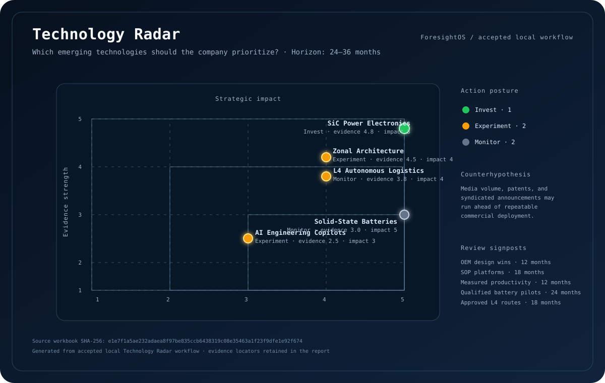

# ForesightOS

ForesightOS is an evidence-aware strategic reasoning system for turning a
decision question and structured source material into traceable claims,
implications, recommendations, and revision-bound local artifacts.

It is built for decisions that need more than a plausible answer: the evidence
must be locatable, the reasoning must be reviewable, changed evidence must be
able to invalidate earlier work, and blocked boundaries must remain explicit.

## See the system


**Text fallback:** A strategic question is framed with horizon and constraints,
then passed through traceable evidence gathering and deterministic spreadsheet
checks. Skills and bounded specialists interpret the evidence, an adversarial
review challenges the leading view, and scenarios produce actions and triggers.
The result becomes a report or presentation artifact. If evidence changes, the
system records the change and selectively reassesses affected work instead of
silently rerunning everything.

The static image is the repository-friendly view. [Download the interactive
flowchart (open locally)](docs/assets/foresight-os-flow.html) to use Archify’s
theme controls, route tracing, and export menu. GitHub displays
the HTML as a file; download it and open it locally for the interactive viewer.

## What makes ForesightOS different

| Need | ForesightOS approach |
|---|---|
| Evidence that can be checked | Source locators, hashes, structured claims, and finding views stay attached to analytical state. |
| Repeatable reasoning | Versioned skills and task-shaped execution recipes keep responsibilities bounded and inspectable. |
| Review before acceptance | Challenges, counterhypotheses, disconfirmation conditions, and human decisions are recorded explicitly. |
| Deterministic analysis | Local CSV/XLSX workflows run through checked spreadsheet readers and reproducible calculations. |
| Changed assumptions | Invalidation metadata and selective reassessment preserve what remains valid while targeting what changed. |
| Honest boundaries | Missing inputs, failed checks, unavailable providers, and unresolved issues remain visible statuses. |
| Durable outputs | Reports and optional presentations are linked to accepted revisions rather than detached model responses. |

## See it in action: Technology Radar

The checked-in Technology Radar fixture asks: **Which emerging technologies
should the company prioritize?** The accepted local workflow uses a 24–36 month
horizon and produces this conditional posture:



*Source-derived snapshot from the accepted local workflow. Workbook SHA-256:
`e1e7f1a5ae232adaea8f97be835ccb6438319c08e35463a1f23f9dfe1e92f674`.*

- **Invest:** SiC Power Electronics.
- **Experiment:** AI Engineering Copilots and Zonal Architecture.
- **Monitor:** L4 Autonomous Logistics and Solid-State Batteries.
- **Counterhypothesis:** media volume, patents, and syndicated announcements
  may run ahead of repeatable commercial deployment.
- **Review signposts:** independent OEM design wins, platforms entering SOP,
  measured productivity studies, automotive-qualified battery pilots, and
  regulator-approved commercial L4 routes.

Run the same provider-free workflow from the repository root:

```powershell
python -c "from pathlib import Path; from foresight_os.analysis.technology_radar import run_technology_radar_workflow; from foresight_os.domain.challenge import derive_finding_views; from foresight_os.persistence.analysis_store import AnalysisStore; r=run_technology_radar_workflow(AnalysisStore(Path('.tmp-tests/readme-showcase/radar-case')), Path('tests/fixtures/exercise/04_Technology_Radar.xlsx'), human_decision='ACCEPT'); report=r.report_path.read_text(encoding='utf-8') if r.report_path else ''; assert r.status == 'accepted' and r.report_path and r.report_path.exists() and all(item.accepted for item in derive_finding_views(r.analysis)) and all(section in report for section in ['Signal quality', 'Competing hypotheses', 'Alternative futures', 'Action category', 'Signposts']); print(f'{r.status}: {r.report_path}')"
```

The command requires no provider authentication and writes only to the existing
ignored `.tmp-tests/readme-showcase/` directory.

## Five-minute local quickstart

Requirements: Python 3.11 or newer and the project dependencies.

```text
python -m pip install -e .
python -m foresight_os.cli --help
python -m foresight_os.cli analyze --workbook evaluation/cases/case-001/workbook.csv --work-dir work/docs-quickstart --accept
python -m foresight_os.cli report --work-dir work/docs-quickstart
```

The local fixture path requires no provider authentication. The analysis command
returns an accepted status and writes state under `work/docs-quickstart/`.
The report command writes:

```text
work/docs-quickstart/artifacts/executive-report.md
```

The CLI also supports `inspect-powerbi` for metadata-only project inspection,
`challenge` for recording a review challenge, and `scope-change` for recording
a changed decision scope. Use each command’s `--help` output for the current
required arguments.

To continue after changed evidence:

```text
python -m foresight_os.cli continue --work-dir work/docs-quickstart --changed-id claim-northern-demand-growth --reason "Updated source evidence"
```

See [Getting Started](docs/getting-started.md) for expected outputs, state
inspection, troubleshooting, and the difference between the local CSV path and
optional XLSX, Power BI, or provider boundaries.

## Strategic foresight toolkit

ForesightOS keeps orchestration as an enabler rather than treating it as the
product outcome. The repository provides reusable patterns for:

- **Direct work:** one bounded specialist answers a focused question.
- **Sequential work:** later stages consume explicit outputs from earlier stages.
- **Concurrent work:** independent research lanes run under shared limits.
- **Handoff work:** a specialist produces a durable receipt for the next role.
- **Group-chat work:** multiple bounded perspectives converge through recorded
  findings and review decisions.

Each recipe resolves skills and runtime capabilities without merging their
responsibilities. The resulting stages carry participants, dependencies, limits,
expected results, and execution receipts.

## Architecture at a glance

```text
WorkBrief
  -> controller policy and ExecutionRecipe
  -> RecipeStage
  -> participants + skills + capabilities
  -> bounded workflow and stage receipts
  -> AnalysisState
  -> review and finding views
  -> report or optional presentation boundary
```

The `WorkBrief` captures the decision question, objective, horizon, constraints,
stages, participants, and research needs. The controller turns it into a
recipe. `AnalysisState` is the durable analytical owner for evidence, claims,
implications, recommendations, calculations, relationships, artifacts,
revisions, review records, and invalidation information. `AnalysisStore` writes
validated state atomically and keeps pending mutations separate from accepted
revisions.

Reports are derived from committed state. Optional presentations are revision-
bound and cannot be sent to an external destination without the existing human
approval and durable receipt boundary.

See [Architecture](docs/architecture.md) for the runtime flow and state model.

## Built to be checked

| Evidence layer | What the repository can prove | What it does not prove |
|---|---|---|
| Structural | Schemas, hashes, persistence, invalidation, fixture determinism, and boundary handling. | Strategic usefulness by itself. |
| Analytical | Source-linked calculations, finding acceptance, review records, scenarios, and signposts. | That a model or provider is always correct. |
| Human decision | Explicit acceptance, challenge, and unresolved review state. | That a recommendation is right for every organization. |

Common statuses are:

- `VERIFIED`: required deterministic checks passed;
- `FAILED`: an attempted operation or acceptance check failed;
- `BLOCKED_INPUT`: approved inputs are absent or incomplete;
- `BLOCKED_EXTERNAL`: a provider or protected external boundary is unavailable;
- `not_measured`: a required human or performance measurement was not collected.

ForesightOS does not treat a model response or an external provider result as
accepted evidence automatically.

## Documentation

Use [the documentation index](docs/README.md) for maintained user-facing guides:

- [Getting Started](docs/getting-started.md)
- [Architecture](docs/architecture.md)
- [Skills and Capabilities](docs/skills.md)
- [Evidence and Evaluation](docs/evidence-and-evaluation.md)
- [Configuration](docs/configuration.md)
- [Extending ForesightOS](docs/extending.md)

The repository also retains historical plans and durable evidence under
`docs/intent/` and `docs/superpowers/`. Those records remain source-specific
and are not duplicated into onboarding pages.

## Repository map

```text
src/foresight_os/       runtime, domain, controller, persistence, artifacts
evaluation/              frozen cases, rubrics, probes, and reports
tests/                   unit and contract tests
docs/                    maintained user guides and durable project records
schemas/                 checked-in schema inputs
scripts/                 repository maintenance helpers
```

The implementation and tests are authoritative when this overview and source
behavior differ.

## Development checks

Run the full test suite from the repository root:

```text
python -m pytest -q
python -m compileall -q src tests evaluation
```

For configuration, use `.env.example` as the variable inventory. The runtime
reads inherited environment variables; it does not automatically load `.env`.
Keep credentials out of source, state, receipts, and public documentation.

For contribution workflows, start with [Extending ForesightOS](docs/extending.md)
and keep new behavior inside its existing owner rather than adding a parallel
registry, store, or evidence format.
